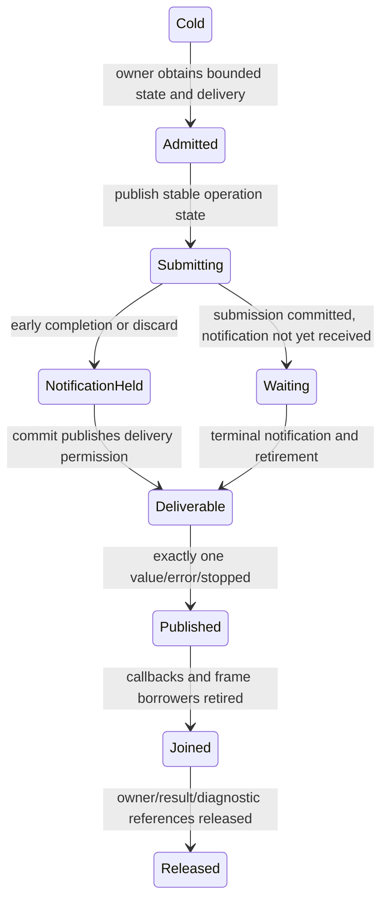

# Concrete runtime contract

T03 design decisions for the redesign. These declarations describe the target API, not APIs already
implemented. Requirements remain authoritative; current API documentation changes with implementation.

## Task, environment, and completion

The public computation type remains `Task<T, E = NoError>`. A task contains either an owned cold coroutine
handle or an inline `Completion<T, E>`. `Task<T, E>::FromValue(T)` and `Task<void, E>::FromValue()` construct
ready values; `FromCompletion(Completion<T, E>)` accepts any terminal outcome without a runtime allocation.
Payload construction can itself allocate; that is distinct from task machinery. Empty/moved-from tasks are
invalid computations, not implicit successful void tasks. Awaiting consumes a task exactly once, including
when the source expression is an lvalue; a second attempt produces InvalidTaskUsage.

`CompletionKind` has exactly `Value`, `Error`, and `Stopped`. Pending state is represented by the absence
of a Completion in running state. `Completion<T, E>` exposes `Kind()`, `Value()`, `Error()`, and `StopReason()`.
`AsyncError<E>` distinguishes an E payload from AsyncFault inside the Error channel. It can hold an inline
payload or an explicitly retained immutable payload from a concurrent operation. This allows scope/race
reports and a result consumer to retain the same error without copying a move-only E or making ordinary
successful tasks shared. Concurrent state stores the original error inline; returned error references alias
that state's control block and must not be stored back into the same state, which would create a cycle.

Stop reasons distinguish a user request, deadline, owner closure, and runtime shutdown. Stop is published
only by a cooperative completion point. Merely requesting stop cannot replace an existing value/error.

`AsyncEnvironment` is a typed value containing an ExecutorRef suggestion, CancellationToken, optional
monotonic deadline, `std::pmr::memory_resource*`, optional borrowed metadata pointer, and optional integer
priority hint. The allocator defaults to the standard PMR resource; null resources are invalid input.
Metadata and allocator objects must outlive the work that borrows them. Environment copies allocate no
storage; copying a nonempty token may retain its existing state but never links sources or registers callbacks.
Cold coroutine frames use the default coroutine allocation policy. A starter's later environment controls
only allocations made after startup; it does not retroactively select the frame allocator.

`TaskContext` remains the explicit starter/context interface and gains construction from AsyncEnvironment.
`co_await CurrentEnvironment()` accesses the active promise's environment. Nested task startup snapshots
that environment; the current executor suggestion belongs to the computation, not to an ambient thread.
Absent properties have no dynamically allocated container. Explicit context-taking leaf APIs must resolve
logical inheritance at their actual suspension boundary: a caller-selected delivery executor is explicit,
but it cannot erase inherited stop/deadline state. Where a distinct explicit token must be combined, link
once at that operation boundary, never at intervening helper frames. In-scope callers should pass the
current context rather than a stale outer context after an explicit transition.

The task awaiter owns the child frame until result propagation and frame retirement. Successful direct
await transfers to the child and back using coroutine-handle transfer. Failure propagation must also use
bounded stack space: do not recursively call completion handlers down an arbitrarily deep ancestor chain.
`task.AsCompletion()` consumes the task but returns its complete outcome to the awaiting body, allowing a
transition/scope helper to clean up before propagating failure. It is not another independently started task.
Ordinary awaiting propagates failure; adapters that explicitly return Completion remain the inspection path.

## Execution transitions and the chain delivery slot

The signatures are:

```cpp
template<class T, class E> Task<T, E> StartsOn(Execution::ExecutorRef, Task<T, E>);
template<class T, class E> Task<T, E> ContinuesOn(Execution::ExecutorRef, Task<T, E>);
auto SwitchTo(Execution::ExecutorRef); // awaitable; changes the active default
auto YieldNow();                       // awaitable; always defers
```

StartsOn admits the startup transition before entering the child and supplies its executor as the child's
default. ContinuesOn preserves incoming startup, reserves its terminal-delivery transition before starting
the child, and applies it to value/error/stopped alike. Neither operation implicitly restores the original
executor. SwitchTo changes only the executor property. Ordinary child completion transfers the child's
current execution placement to the parent. Cancellation, deadline, allocator, and metadata remain logical
properties across execution transitions. Unsupported/rejected transition admission starts no inner work
and reports an actionable scheduling error to the existing owner.

A running root or spawned operation owns a **chain delivery slot**: one reusable reserved callback and
storage for the chain's next deferred continuation. Ordinary sequential helpers borrow that slot. They do
not independently reserve completion capacity or own publication/observer lists. A pending backend request
still owns its backend admission and retirement state; sharing a chain slot does not remove these bounds.

A slot's callback first moves pending work out of the slot, then invokes it after queue locks are released.
At most one suspension in the sequential chain is awaiting an external notification. Slot reuse is therefore
serialized by the coroutine suspension/publication protocol, not by allowing concurrent writers to pending
work. Requeue while its callback is running uses the queue's existing one-pending-delivery support. The old
callback must not read mutable pending-work storage after invocation begins.

An executor transition acquires target delivery capacity before relinquishing the prior guarantee. A
ContinuesOn boundary may retain a separate terminal ticket while its child transitions elsewhere; this is
an explicit placement boundary, not a cost added to every helper. A slot cannot refer to a helper frame
that may be destroyed before the slot's callback. Slot storage is rooted in the concurrent owner's state.

`Execute` remains enqueue-only. Eligible inline dispatch is a distinct operation that requires IsCurrent,
fully published results, completed required retirement, no internal locks, and available depth/work budget.
Stage 1 uses a 256-transfer chain work budget, a 16-level nested-dispatch depth budget, and a default
64-unit runtime poll allowance; T09 records the measured tradeoffs in Design and Measurements.
Every direct transfer, including return transfers, consumes work budget. Reaching the budget queues the
chain through its already-owned slot. Runtime PollOnce must charge these transfers against its bounded
batch work; it cannot charge only initial queue dequeue and permit unlimited transfers afterward.

## Publication and retirement protocol



The implementation needs separate facts for submission committed, notification recorded, terminal claimed,
and required borrowers retired. An early callback records its notification in stable operation state, but
cannot enter application code until submission commits. The side observing both commit and notification
owns scheduling. Results are written before release publication; consumers acquire before reading. After
publishing a continuation, code may use only independently retained operation state, never the awaiter's
possibly destroyed coroutine frame. Rejection and discarded work participate in the same handshake and
cannot both resume a coroutine. The exact atomic layout is internal; controlled tests verify both orders.

Cancellation records a request and asks the backend to stop. It does not claim join completion or free a
buffer. Backend completion decides the terminal outcome at its documented arbitration point. Registration
Reset joins an invocation on another thread before observer/frame state can be released. Callback-initiated
unregister uses the existing stable node lifetime; it cannot wait for itself. Native requests retire before
buffer release even when cancellation was requested earlier. Pending work never falls back to an
unauthorized inline callback when queues fill.

## Structured owners and result handles

```cpp
template<class E = NoError> class TaskScope;
template<class T, class E = NoError> class Operation;

// TaskScope<E> members; every admitted child uses E.
template<class T>
std::expected<Operation<T, E>, Execution::ScheduleError> Spawn(Task<T, E> task);
void Close() noexcept;
void RequestStop() noexcept;
auto Join(); // asynchronous; returns a ScopeReport<E> after all children retire
```

The scope constructor takes an environment and positive admitted-child capacity. Its child table is
allocated/reserved once. Admission reserves the child record, its delivery slot, and needed completion
notification before starting a body. A rejected cold input is destroyed without starting. Each child gets a
monotonic spawn index; completed children remain represented until scope Join so the report cannot depend
on slot reuse. A scope owns one cancellation source linked to a nonempty parent only once. Operation handles
normally have no independent stop source.

Operation is move-only and singly consumes its result. `co_await operation` waits for and consumes its
Completion; `TakeResult()` is the corresponding already-complete inspection path. A second consumption is
InvalidTaskUsage. Dropping a handle only drops the result consumer. The scope retains execution state and
still observes errors, requests stop, and joins the child. Read-only notification observation is separate
from result consumption. The root used by SyncWait/RunTask uses this same ownership machinery. Ownerless
Spawn/Detach APIs are removed when their consumers migrate; no permanent legacy owner path remains.

`ScopeReport<E>` contains stable spawn-ordered errors and stopped information. Child error publication
requests sibling stop promptly, independently of when Join is called. Stopped alone does not replace an
error or trigger a fictitious failure. After cleanup, body error is primary; otherwise the lowest spawn-index
observed child error is primary. Reports retain errors by aliasing the retired child records, within admitted
capacity. They do not require a reusable shared-result facility for ordinary values.

The normal helper is `WithScope<E>(environment, capacity, body)`, where body is an owned callable accepting
`TaskScope<E>&` and returning `Task<T, E>`. The helper returns `Task<T, ScopeFailure<E>>`; ScopeFailure retains
the primary AsyncError<E> and stable secondary diagnostics. Body success yields T after joining; body/child
stop yields Stopped if no error occurred. A body error takes precedence over child errors. The helper retains
the callable, closes admission, requests stop on body exit/failure or parent cancellation, and joins before
returning. No coroutine destructor awaits or blocks. Destruction of a low-level owner with live work fails
fast in release builds.

C++ lifetime restriction: an outer helper cannot postpone destruction of a callback coroutine's automatic
variables when that callback returns. Borrowed resources must live in the enclosing caller or in owned
captures/state retained by WithScope through join. A callback local borrowed by children requires joining
those children before leaving that local's lifetime. The helper's guarantee is complete child ownership and
cleanup, not automatic extension of arbitrary C++ references.

## Observation, race, and deadlines

`Operation::Observe()` returns a notification-only reference. `FirstCompleted(span<OperationRef>, token)`
returns `Task<CompletionNotification>` with index and terminal kind, without taking values or stopping work.
The optional token cancels only the observation. A pending observer allocates bounded records at this
boundary, unregisters every losing record before returning, and leaves execution with its existing owner.
Precompleted inputs use input order. For concurrent notifications one mutex/atomic winner claim is the
single arbitration point; notification publication, not subsequent executor dispatch order, selects the winner.

`Race` retains the existing variadic factory use case from WhenAny. Each factory accepts a child context
and returns a Task with the same E; successful value types may differ. The result is a
`Task<RaceWinner<Ts...>, RaceFailure<E, Ts...>>`. RaceWinner retains input index and a variant value (a void
alternative uses monostate). RaceFailure retains winner information and bounded errors; it does not discard
loser errors. The owner admits all competitors before executing any factory, closes admission, chooses the
first terminal outcome, requests loser stop, and joins all competitors. An error winner stays primary;
otherwise any loser error overrides a successful/stopped winner, whose information remains retained. With
no errors a stopped winner yields Stopped. This replaces WhenAny, including its tests and benchmark callers.

`WithDeadline(TimePoint, Task<T,E>) -> Task<T,E>` creates a cancellation/timer boundary only for a stricter
local monotonic deadline. `WithTimeout(duration, task)` computes the deadline once when that boundary starts,
not during cold task construction or in every descendant. An earlier inherited deadline shares its owner.
A stricter boundary admits a removable timer and links stop once before starting inner work. Early terminal
completion removes/joins the timer; expiry requests stop and the wrapper joins actual inner completion even
past the deadline. Unsupported timer-removal admission fails before starting the inner work. Wait-only
strict timeout composes observation cancellation with an independently owned operation; it is not this wrapper.

## Application ownership and shutdown

An application supervisor uses the same bounded owner/child-record implementation, with explicit lifetime
transfer and a nonblocking error sink. A missing sink retains admitted errors, closes admission, and requests
supervisor stop; its shutdown report exposes them. Retention cannot exceed admitted child capacity, and a
failure to report never silently clears an error. User-provided sinks must be noexcept and nonblocking and
are called outside internal locks, after operation retirement.

Shutdown status distinguishes backend retirement, completion handed to external executors, and application
owner join. Runtime::Shutdown does not claim to join unrelated application work. A timed owner shutdown can
return Incomplete while that still-live owner retains all running records; a later join remains required.
No timeout destroys a cooperative frame. External executors outlive and drive all their admitted deliveries.
The shutdown path uses capacity reserved before work started. Runtime loop ownership remains fixed and loop
driving remains non-reentrant.

## Caller examples and regression map

The following sketches use the target signatures. They become compilable consumer tests as each API lands.

```cpp
Task<int> Compute();

Task<int> AffineCaller(Execution::ExecutorRef ui, Execution::ExecutorRef worker) {
    // Both terminal failure and success are delivered on ui.
    co_return co_await ContinuesOn(ui, StartsOn(worker, Compute()));
}

auto result = WithScope<NoError>(environment, 8,
    [](TaskScope<NoError>& scope) -> Task<int> {
        // value() reports rejected admission as a body exception; applications may
        // instead explicitly inspect the ScheduleError before taking the handle.
        auto child = scope.Spawn(Compute()).value();
        co_return co_await child; // Operation yields the complete typed outcome.
    });
```

For an early-return body that starts work borrowing a buffer, retain that buffer in the owned callback's
capture/state, or in the enclosing coroutine awaiting WithScope. Do not declare it as a temporary callback
local and return while a child still borrows it. Dropping the Operation handle does not release the scope's
child record or cancel the child. Body exit still initiates structured stop and joining.

| Existing fixture | Assertion preserved or intentionally changed |
| --- | --- |
| `tests/Async/ChildLifetime.cpp` | Cancellation joins actual work; backend/child borrowing ends before parent release |
| `tests/Async/ExecutorAffinity.cpp` | Replace implicit restoration on ordinary Task await with explicit ContinuesOn; retain explicit observer delivery tests |
| `tests/Async/TaskScope.cpp` | Keep bounded admission and retirement checks; change error arbitration to spawn order and add body-helper coverage |
| `tests/Async/Race.cpp`, `tests/Async/FirstCompleted.cpp` | Owning race diagnostics and non-consuming observation |
| `tests/IO/AsyncDispatchTests.cpp` | Preserve controlled worker/cancel interleavings, rejection before side effects, and shutdown/external delivery |
| `tests/IO/RuntimeLoopTests.cpp` | Charge direct chains to PollOnce work budget and preserve non-reentrant owner driving |
| `benchmarks/AsyncRuntimeBenchmarks.cpp` | Eligible helpers reach zero incremental submissions/reservations/registrations; ready storage gets its own zero-allocation case |

New Stage 1 cases must also cover deep success and failure without recursive stack growth, child completion
before submission returns, deferred delivery under saturation, result moves that throw, invalid/moved-from
consumption, and exact logical-environment preservation across all terminal transition paths.
