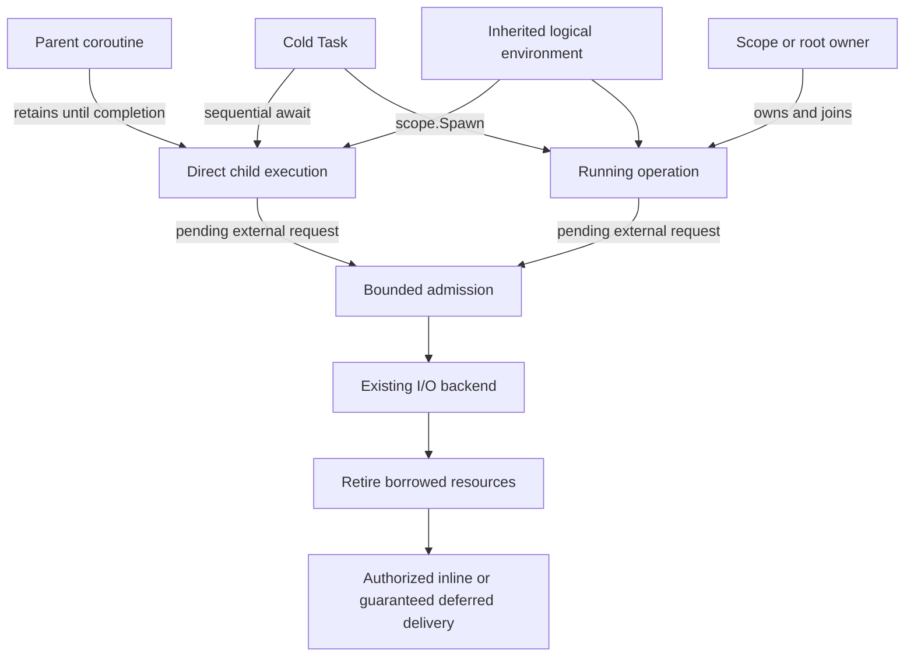

# Async Runtime Design

Date: 2026-09-12

Status: proposed design; implementation work is tracked in [Tasks.md](Tasks.md).

[Requirements.md](Requirements.md) defines the acceptance contract. This document describes how to meet it
and preserves the execution/ownership decisions from [AsyncRuntimePlan.md](../AsyncRuntimePlan.md).
Names below describe target semantics. [Contracts.md](Contracts.md) records the concrete T03 API and
publication/ownership decisions; implementation and measured budget tuning remain tracked in Tasks.

## D1 — Architecture and change boundaries

Requirements: [R01](Requirements.md#r01--preserve-the-runtime-foundation),
[R20](Requirements.md#r20--attribute-performance-costs-before-redesign),
[R23](Requirements.md#r23--complete-the-consumer-and-documentation-transition).

Separate sequential coroutine execution from concurrent operation ownership. Keep backend admission and
retirement in the shared runtime and its services. The design must not require a scheduler hop or concurrent
tracking allocation merely because an implementation uses another helper coroutine.

| Owner | Responsibilities | Existing implementation starting points |
| --- | --- | --- |
| Async sequential task | Cold frame/ready representation, direct child continuation, inherited environment, terminal result | `Task.hpp`, `TaskContext.hpp`, `Completion.hpp` |
| Async concurrent owner | Spawned operation lifetime, scope membership, stop authority, asynchronous joins, aggregation | `TaskScope.hpp`, operation/root helpers, combinators |
| Execution | Authorized dispatch, explicit enqueue, executor transitions, depth/work budgets, guaranteed deferred delivery | `ExecutorRef.hpp`, schedulers, completion and timer reservations |
| IORuntime | Loop ownership, shared polling/timers, wakeups, service admission, shutdown progress | `RuntimeLoop`, `RuntimePoller`, `Runtime`, `RuntimeRunner`, `RunTask` |
| IO | File ordering/leases, backend requests, native/fallback retirement | `FileOperationGate`, `AsyncFileHandle`, `FileSystemDriver` |
| Net | Socket concurrency, native/fallback requests, cancellation and retirement | `NetworkDriver`, `SocketState`, socket implementations |

`Async` remains part of the existing build ownership; this table does not introduce a new component.
Keep non-template/platform implementation compiled under `src/`; public templates and contracts remain in
`include/`. Reuse existing first-party facilities before introducing new abstraction families.

The diagram separates lifetime owners; it does not require a heap object or public type for every box.

### Evidence before layout changes

The current tracked task startup reserves delivery capacity and submits work; the file gate wrapper starts
and awaits a backend task. Empty cancellation tokens already skip callback registration. Measure these
mechanisms separately before assigning blame to cold startup or cancellation support in general.

The frozen implementation checkpoint is Base commit `7792846`; `b44612e` adds the original redesign plan
without changing production code. The historical baseline remains
`203f704e97a704259ef2db1ee8c93bf92763a7e1`. Record full source/build identities when benchmarking.
The latest recorded native read and fallback read/write mean regressions are approximately 39%, 48%, and 54%;
the dominant cause remains unproven. Use [IORuntimeMeasurements.md](../IORuntimeMeasurements.md) as evidence.

## D2 — Execution model

Requirements: R02–R07, R08, R17.

### 2.1 Cold computation and running work

`Task<T>` describes a lazy, move-only, single-consumer computation. Constructing it does not schedule its body.
The generic spelling may retain an error parameter where useful; `Task<T>` below is shorthand.

- `co_await child` starts a sequential child directly when possible. The parent owns the child until completion.
- `scope.Spawn(child)` creates concurrent work and returns a move-only `Operation<T>` result handle.
- The scope retains ownership of spawned work even if its result handle is dropped. Dropping the handle does
  not detach, cancel, or free a running child's state.
- A root runner or explicit application supervisor supplies ownership outside a lexical task scope.
- An unstarted task can be destroyed without starting it. A running operation cannot be abandoned by
  destroying the only object responsible for its execution lifetime.

Sequential composition does not require a child scope, queue item, stop source, observer list, or reusable
completion reservation per coroutine layer. Keep its state sufficient for parent/child suspension and
result propagation. Use symmetric transfer or an equivalent bounded-stack mechanism.

Concurrent operation state owns the additional publication, cross-thread completion, and scope membership
machinery. Do not duplicate this ownership in every helper frame or expose extra public task types solely
to distinguish storage optimizations.

Provide an inline ready-result representation within the ordinary task API with no required queue hop or
heap allocation. Arbitrary coroutine frame allocation remains compiler- and allocator-dependent; portable
frame elision is not a universal guarantee. Report frame allocation separately from runtime bookkeeping.

Single consumption is the default. Multiple result consumers require an explicit shared/fan-out facility
with documented synchronization and retained-result costs. Do not add that cost to ordinary tasks; implement
such a facility only when a concrete consumer needs it.

### 2.2 Execution environment

The starter supplies an `AsyncEnvironment`. Nested tasks inherit its logical properties:

- Suggested/default executor.
- Cancellation token and effective deadline, if present.
- Allocation resource for allocations performed after the environment becomes available.
- Optional tracing/task-local metadata and priority hints.

Use a small typed environment and existing context facilities. Do not introduce a dynamic property registry,
an observability subsystem, or priority scheduling algorithms just to populate these fields. Absent optional
properties must not allocate. Environment storage and referenced resources must outlive their borrowers.

A cold coroutine frame can be allocated before the starter's environment exists. Do not claim that a later
inherited allocator controls that allocation. Use an explicit construction allocator where supported, or
document the frame's default allocation policy; measure it separately.

The suggested executor is not permanent affinity. Do not capture arbitrary ambient UI/thread-local state,
or infer execution permission merely from the executor stored in a context. Executor transitions preserve
cancellation, deadline, allocator, and logical metadata unless a named boundary explicitly overrides them.

### 2.3 Explicit transitions

The following names describe target semantics; finalize their signatures before changing call sites.

| Operation | Contract |
| --- | --- |
| `StartsOn(executor, work)` | Start the inner computation on that execution resource and supply it as the inner default. The inner computation may subsequently transition. No implicit return to the caller's original executor. |
| `ContinuesOn(executor, work)` | Start the inner computation under the incoming environment; deliver its terminal value, error, or stopped completion on the specified executor. |
| `SwitchTo(executor)` | Move the current computation to that resource and make it the subsequent default, preserving logical context. May complete inline when already permitted there. |
| `YieldNow()` | Defer the current computation through its current execution resource so other eligible work can progress. It must not optimize into an inline no-op. |

Ordinary awaiting does not silently restore the pre-await execution resource. A thread-affine caller uses
an explicit completion transition when calling work that may switch resources. A leaf I/O API documents
its completion resource; backend threads must not arbitrarily run application continuations.

### 2.4 Inline dispatch and fairness

Both ready and previously pending completions may continue inline when the dispatch contract permits it.
Keep submission/enqueue distinct from a dispatch operation that may execute inline. Do not globally change
`Execute` into an inline call and thereby change existing queue and yield semantics accidentally.

Inline dispatch requires all of the following:

1. The current thread is in an authorized execution context for this continuation.
2. The operation has published its result and completed the required backend retirement.
3. No internal lock is held and no protected submission/publication transition is exposed to reentrant code.
4. There is no explicit isolation requirement, and the executor's depth and work budgets permit it.

Otherwise defer through a bounded delivery path. Track both nesting depth and work performed: symmetric
transfer can avoid stack growth while still starving timers or unrelated work. Runtime `PollOnce()` and
executor fairness budgets must account for inline continuation chains, not just dequeued items.

Reserve a deferred-delivery path at the owning root/spawn/suspension boundary before it is needed. A sequential
chain may reuse that guarantee; do not reserve one slot per helper. Publish resumable state before another
thread can complete it, and do not touch a potentially destroyed coroutine frame after publishing its continuation.

Queue saturation must never force execution on an unauthorized thread or strand accepted work. If a custom
executor cannot provide safe inline dispatch or guaranteed deferred delivery, use its queued contract and
reject unsupported admission before starting external work.

## D3 — Cancellation, completion, and ownership

Requirements: R08–R14, R17.

### 3.1 Cancellation cost and authority

The owner/scope normally holds the cancellation source. Descendants receive the token through the environment.
Passing it through an ordinary helper must not create another source, linked state, or registration.
Register only at operations that need notification while suspended, such as a pending backend request or timer.

For a token that cannot stop, require zero cancellation-specific allocations, registrations, and synchronization
on the execution path. This does not remove synchronization needed for cross-thread I/O or completion itself.
Poll the token at documented cooperative points where no callback is necessary.

An independent per-operation stop source is an explicit ownership option, not part of every result handle.
Link sources once at a real cancellation boundary. Scope stop propagates to owned descendants automatically.
Cancellation shielding is not required for the first implementation; if introduced, it cannot bypass joining
or runtime shutdown, and must make its bounded cleanup purpose explicit.

### 3.2 Exactly three terminal channels

Use `Value`, `Error`, and `Stopped` as the only infrastructure terminal categories. `Pending` is a lifecycle
state, not a fourth terminal channel.

Retain typed API errors where useful: the `Error` payload can distinguish an API-specific error from an
infrastructure fault/exception. Collapse today's separate `DomainError` and `Fault` terminal categories into
that one error channel. Expected domain outcomes may instead be normal `Result`/`Expected` values when that
fits the API. Do not force every API into a nested result or discard existing error information.

`Task<void>` remains awaitable with observable failure. All await adapters, generators, combinators, root
runners, and completion inspection APIs must agree on the three-channel model.

`RequestStop()` is a request, not completion. A success racing with a stop request may remain successful;
exactly one terminal publication wins according to the operation's documented synchronization point.
Do not overwrite a published value/error simply because cancellation is subsequently requested.

An operation is join-complete only when the backend and callbacks no longer borrow its operation resources.
Internal bookkeeping may retire later only if it no longer references caller-owned state. The caller must
keep borrowed buffers and resources alive through this completion; the runtime does not make arbitrary
early buffer destruction safe.

### 3.3 Canceling work versus canceling a wait

Stopping an owned operation requests cancellation and still requires joining actual completion before
releasing its borrowed resources. A cancellable observer wait may finish earlier only when another owner
retains the operation and its resources and guarantees eventual cleanup.

Keep these as distinct APIs. A wait-only cancellation path unregisters its observer safely before releasing
observer state. It does not steal a single-consumer result, release backend buffers, or implicitly detach work.

### 3.4 Structured scope closure and sibling failure

Provide an awaiting scope helper for the normal case: run the body, close admission, and asynchronously join
all children before returning. On body failure, child failure, or parent cancellation, request sibling stop
promptly and then join. A low-level explicit `Close`/`Join` path may support advanced callers.

A scope destructor cannot secretly block an executor or detach unfinished children. Destruction with live
children is a documented contract violation with a release-build fail-fast path; debug assertions alone are
insufficient. The normal awaiting helper must handle early return and exceptions without reaching that path.

Default scope policy is fail-fast cancellation with complete cleanup:

- Any child `Error` requests sibling cancellation as soon as it is observed.
- After joining, a body error is primary; otherwise choose the lowest spawn-index observed child error.
- Retain additional errors in stable spawn order, bounded by admitted child capacity. Error takes precedence
  over stopped outcomes; cancellation alone is not reported as failure.
- Without errors, return `Stopped` if the scope body or an owned child completed stopped; otherwise return value.

This ordering is deterministic for the errors actually produced. Which failures occur before cooperative
cancellation takes effect can still depend on scheduling. An independent-failure supervisor, if needed,
must be a named policy rather than an accidental consequence of dropping child handles.

### 3.5 Observation and competition

`FirstCompleted` observes externally owned operations. It returns the first terminal notification without
canceling other operations or consuming their values. Multiple already-terminal inputs are ordered by input
index; concurrent publications use one defined winner arbitration point.

Observation must not silently turn every task into a shared task. Use explicitly registered, bounded
observation state at this combinator boundary. The owner remains responsible for joining operations.

`Race` owns its competitors. The first terminal outcome wins, including an error or stopped outcome. It then
requests loser cancellation and joins all competitors before returning. This is distinct from first-success.
Concurrent winners use a single arbitration point; already-terminal ties use input order.

Preserve loser errors as bounded secondary diagnostics. If the winner succeeded but a loser reports an error
during termination, return an error with the winner information retained; otherwise preserve the winner's
error as primary. An error takes precedence over a stopped winner. Document this policy so cleanup failures
are never silently discarded.

Replace the existing owning/canceling `WhenAny` behavior with the explicit `Race` contract and update its
callers. Do not keep two incompatible meanings under the same name.

## D4 — Deadlines, detached work, and shutdown

Requirements: R15–R17, R19.

### 4.1 Deadlines and timeouts

Use monotonic absolute deadlines. Convert a relative timeout once at its ownership boundary; descendants
inherit the earlier of their own and their parent's deadline. Do not restart the timeout in every helper.

An inherited deadline shares its owner's timer/stop state. A stricter local deadline creates a new boundary
and pays for its own bounded timer. Expiry requests stop; it cannot release resources still used by the backend.
Record deadline expiry as a stopped reason when it causes stopped completion, not as a fourth terminal channel.
A value already won by the completion race remains a value.

A structured timeout returns only after owned work has terminated, so cleanup may extend past the deadline.
A strict limit on observer waiting is a separate wait-only facility requiring continued ownership elsewhere.
Timers must be removed or retired on early completion and count toward admission limits.

### 4.2 Explicit application-lifetime work

Detached work means transfer to an explicit application supervisor, not absence of ownership. That supervisor
provides bounded admission, cancellation, join-at-shutdown, and an unhandled-error sink. All retained buffers
and context must remain valid for the transferred lifetime; scope-local references cannot escape implicitly.

Do not provide an ordinary unobservable `async void` or a naked fire-and-forget detach. Normal `Spawn` always
attaches to an owner. Error reporting must have a defined fallback and must not block the only executor
needed for cleanup. Reuse the root runner/owner where possible instead of adding a separate global service.

### 4.3 Shutdown protocol

Keep user cancellation and runtime shutdown distinct. A cannot-stop user token does not exempt admitted
I/O from runtime shutdown and backend cleanup.

1. Close admission for new roots, spawned work in closing scopes, and new external I/O.
2. Request stop for work owned by the closing scope/supervisor/runtime, according to its ownership boundary.
3. Continue driving backend retirement, already-admitted completion delivery, unwinding, and asynchronous joins.
4. Release native resources only after their requests and callbacks have retired.
5. Finish application shutdown after application-owned roots/scopes and their delivery executors have drained.

Runtime shutdown does not implicitly join arbitrary application tasks on external executors. Distinguish
backend stopped, completion handed to an executor, and application joined in status and documentation.
External executors must remain alive and driven until their admitted continuations and joins finish.
Shutdown must not need new ordinary queue capacity for previously admitted cleanup.

There is no forced destruction of still-running cooperative tasks when a shutdown timeout expires. Report
incomplete shutdown and retain ownership; process-level termination policy belongs to the application.
Preserve fixed loop-thread ownership, non-reentrant loop driving, and notification-driven idle behavior.

## D5 — I/O integration and resource limits

Requirements: R01, R17–R19.

Keep backpressure at places where retained work can grow: roots/spawns, runnable queues, suspended delivery
state, timers, file/socket requests, blocking worker jobs, and explicit observers/shared results.
Reject overload before starting OS work, with an actionable error. Do not block an event-loop thread for capacity.

For every admission boundary, document the limit, when it is acquired/released, and the delivery/retirement
resources it guarantees. Ready operations and nested sequential helpers do not each acquire a generic
operation permit. A pending external request still needs a deliverable completion under full saturation.

Simplify file execution by placing the admission lease, result, cancellation hook, and backend retirement
in the existing operation state where possible. Remove the extra wrapper coroutine/spawn only after its
lifetime and close responsibilities have a concrete owner. Do not replace it with another equivalent layer.

Preserve documented file behavior while changing the implementation: shared-position ordering, independent
offset overlap, and flush/close barriers. The earlier discussion about prohibiting simultaneous reads and
writes did not change that contract. Do not silently serialize all file access or reject supported overlaps
to improve benchmark numbers. Cross-handle filesystem consistency remains a separate API/caller concern.

Preserve supported socket duplex concurrency and native cancellation retirement. Windows `CancelIoEx`,
for example, requests cancellation; it is not permission to free an outstanding request's buffers.

## D6 — Publication and ownership transitions

Requirements: R07–R12, R17–R19. These are logical transitions; the implementation need not use one global
state enum. T03 must specify the exact synchronization and ownership protocol before dispatch is changed.

| Transition | Preconditions and retained ownership | Observable result |
| --- | --- | --- |
| Cold to executing | Parent or concurrent owner installed; environment valid; any required startup capacity acquired | Body starts once |
| Executing to externally pending | Backend request and eventual delivery admitted; continuation state safely published | Backend may complete, including before submission returns |
| Stop requested | Existing owner and buffers remain retained | Request only; no terminal outcome or destruction implied |
| Backend completion to releasable state | Native request/callback no longer borrows operation resources; terminal outcome arbitrated | Value/error/stopped ready for delivery |
| Releasable state to delivered result | Authorized inline dispatch or admitted deferred path; no lock held across user continuation | Awaiter resumes once |
| Scope closing to joined | Admission closed; all owned work complete; required observers safely removed | Scope can return and release borrowed body resources |

A sequential parent cannot destroy its active child while a callback may resume it. Ownership follows the
active coroutine chain even when a leaf switches executors; thread-local identity alone cannot retain a frame.

The submission/completion handshake must cover completion before submit returns, cancellation during callback
registration, executor rejection/discard, and callbacks that resume and destroy their own coroutine state.
After making a continuation resumable, the submitting side must either avoid further access to destructible
state or retain an explicit temporary lifetime guarantee. No user continuation runs while backend/gate locks
are held. Retire callback registrations using their documented concurrent-unregister semantics.

### Capacity and deferral ownership

| Boundary | Capacity acquired before work starts | Release condition |
| --- | --- | --- |
| Root or spawned operation | Owner membership and required runnable/deferred delivery guarantee | Owned operation and delivery no longer need it |
| Pending external operation | Backend/service request and required completion storage/delivery | Native request, callback, and relevant delivery have retired |
| Deadline/timer boundary | Timer entry and notification/retirement state | Timer fired/removed and callbacks retired |
| Explicit observer | Observer record and safe completion/unregister path | Notification consumed or unregister completed |
| Sequential helper | Reuse the active chain's guarantee; no independent generic permit | Parent-child handoff completes |

These are logical budgets, not a requirement for separate allocations per row. T03 must specify whether each
existing reservation is reused, transferred, or replaced and prove that required deferral never depends on
fresh ordinary queue capacity. Queue exhaustion cannot fall back to an unauthorized inline call.

### Stage 1 dispatch budget decision

T09 retains 256 sequential transfers per chain delivery, 16 nested callback dispatches, and a default
runtime poll allowance of 64 shared work units. Entry and return transfers both charge the chain/poll budget;
callbacks charge dispatch work. Existing 64-frame fixtures fit the chain allowance with one delivery, while
10,000-frame chains defer. Recursive dispatch and cross-runtime polls preserve the depth guard.

The [Stage 1 measurements](Measurements.md#stage-1-composition-and-fairness-t09-2026-09-13) compare poll
allowances 16/64/256 on a 4,096-frame chain competing with a due timer and unrelated work. At 64, competing
work runs after 128 entries versus 512 at 256, with approximately 18% greater whole-chain time. Allowance 16
costs approximately 74% more than 64. Retain 64 as the measured throughput/responsiveness compromise;
these internal values are not real-time guarantees or a claim of optimal tuning. Root-startup performance
and the full historical I/O acceptance matrix remain tracked in T23.

## D7 — Implementation decisions to settle from evidence

The behavior in Requirements is fixed for this plan. These implementation details must be recorded during
T03 or their owning task, without reopening the target merely to accommodate the current machinery:

| Decision | Required evidence/constraint | Owning task |
| --- | --- | --- |
| Task frame/ready storage and error payload representation | Frame sizes, allocations, typed error preservation, three terminal tags | T03, T05, T11 |
| Environment lifetime and allocator entry points | No dangling context and no claim of retroactive frame allocation | T03, T06 |
| Dispatch handshake and reservation reuse | Controlled early completion, cancellation, rejection, and saturated deferral | T03, T08 |
| Depth/work budget values | Bounded stack, timer/unrelated progress, measured latency tradeoff | T08, T09 |
| Scope helper and transition signatures | Observable resource placement and exception-safe asynchronous closure | T03, T07, T13 |
| Race diagnostics and supervisor error fallback | Bounded storage, preserved errors, nonblocking cleanup | T15, T17 |
| File lease integration | Profiled wrapper cost and unchanged retirement/order semantics | T20 |

Do not implement optional shared-result facilities, shielding, tracing infrastructure, or priority scheduling
without a concrete consumer. Preserve hooks/semantics without expanding this redesign into those projects.

## D8 — Validation strategy

Requirements: R20–R23. [Tasks.md](Tasks.md) attaches focused checks to each implementation step and records
final evidence. Test observable execution placement, completion, ownership, and progress, with controlled
interleavings for races. Instrument exact costs separately from timed Release runs; instrumentation must not
silently change the workload being compared.

Use the original performance gates in [Requirements.md](Requirements.md#r21--preserve-the-original-performance-gates).
Compare original, frozen pre-redesign, and redesigned sources; separate ready/pending, native/fallback,
runtime/external executor, cancellation modes, and full-fixture/per-operation costs. Do not infer speedup from
reduced counters alone or claim that all file regressions are solved by direct child transfer.

Use repository-defined Linux tests and ASan/UBSan, followed by public-header, installed-consumer, portable-loop,
and Hello.IO checks. The user runs native Windows tests in Windows; do not run Windows binaries or emulation
locally. Record macOS as unverified until native evidence exists. No platform is considered verified from
another platform's successful build/tests.

## References

The source proposal's references are preserved in
[AsyncRuntimePlan.md](../AsyncRuntimePlan.md#9-design-references). P2300 concepts inform the design without
requiring its full framework or C++26. Dispatch, scope failure ordering, race cleanup, deadline, and shutdown
policies here are NGIN choices.
